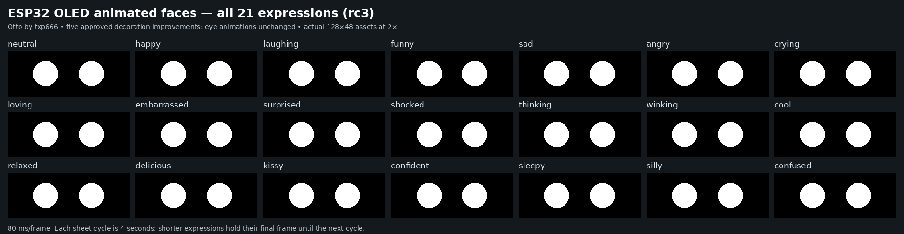
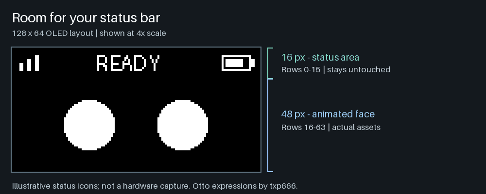

# ESP32 Animated Faces, Eyes & Emoji for 128×64 OLED Displays

21 animated expressions for ESP32 robot faces and OLED displays. The lightweight
C++ player produces **128×48 monochrome frames independently of the display
controller**; the included display examples use SSD1306.

A derivative port of **[Otto Emoji GIF Component](https://github.com/txp666/otto-emoji-gif-component)
by 小鹏 (txp666)**. Otto supplies the expression designs, drawing logic and timing.
This project adds the OLED layout adaptation, offline compression, lightweight
player and firmware integration examples. See [attribution and provenance](docs/PROVENANCE.md).



## Why this exists

XiaoZhi.me can send emotion tags during a conversation. This project gives the
21 standard XiaoZhi emotion labels corresponding animated OLED expressions, so
more of the assistant's expression comes through on a small robot face.

To encourage more expressive output, add this instruction to **Role Introduction**
on your XiaoZhi configuration page, alongside your existing role instructions:

```text
## use emote tags
Remember to send system emote tags during your output so that our output is as expressive as possible. Emotions can change at the start, middle or end of a sentence.
```

The firmware reacts to the tags the service sends. See the
[XiaoZhi guide](docs/XIAOZHI.md#encourage-expressive-emotion-tags) for setup details.

## Space for your status bar

On a 128×64 display, the animation occupies **the bottom 48 rows**, leaving the
**top 16 rows for Wi-Fi, battery and status text**. The XiaoZhi adapter preserves
its existing status UI; the standalone demo leaves this area blank for your own UI.



*Actual face animation with illustrative status icons; not a hardware capture.*

## Get started

- **Add faces to existing firmware:** follow the [component integration guide](docs/INTEGRATION-HANDOFF.md).
  Keep your board configuration, pins, audio and network behavior.
- **Use XiaoZhi:** follow the [XiaoZhi source integration guide](docs/XIAOZHI.md).
- **Try a display-only example:** follow the [standalone SSD1306 demo](docs/STANDALONE.md).

**This is a source component: using it on a device requires rebuilding and
flashing firmware. It is not an animation pack for an arbitrary existing binary.**
The guides cover prerequisites, builds, installation and rollback.

## Small runtime

- 21 expressions and 884 animation frames at 80 ms/frame (12.5 frames/s).
- Approximately **183 KB of compressed assets** in flash, plus metadata and code.
- **768 bytes per decoded frame**, written into a caller-provided buffer.
- No heap allocation in the player and no runtime GIF decoder or Python dependency.
- Emotion mapping, neutral fallback, pause/resume and expression previews.

See the [C++ interface and resource details](docs/API.md) for integration requirements.

## Compatibility and validation

The player is independent of board pinouts and display drivers. The included
examples target ESP32-C3 with a 128×64 SSD1306 OLED; other setups need an appropriate
display adapter and verification.

Rc3 asset/player checks pass. The unchanged adapter and build path were tested on
the preceding candidate; an rc3 firmware rebuild and hardware acceptance remain
pending. See [validation and version pins](docs/VALIDATION.md) for the exact scope.

[Regenerate and test assets](docs/DEVELOPMENT.md) · [Troubleshooting and rollback](docs/RECOVERY.md)

MIT; original notices are retained in [third_party](third_party/). This is a
community derivative, not an official Otto, XiaoZhi or board-vendor release.
